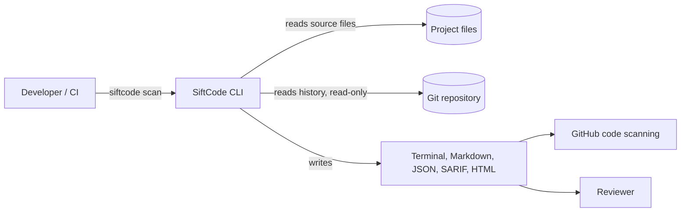
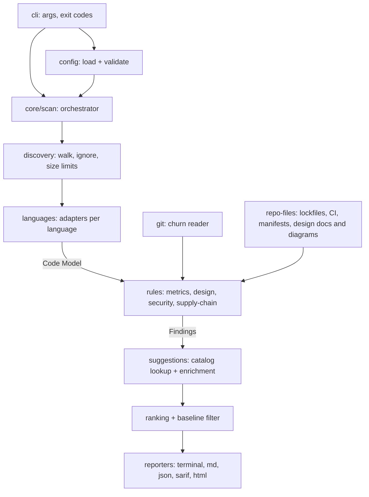
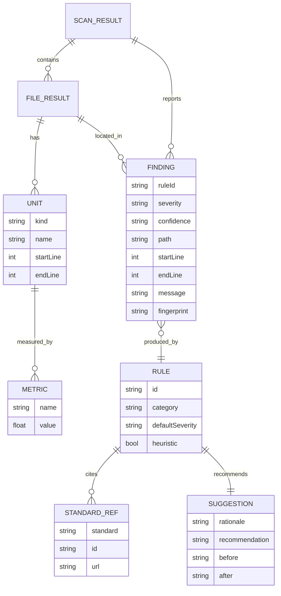
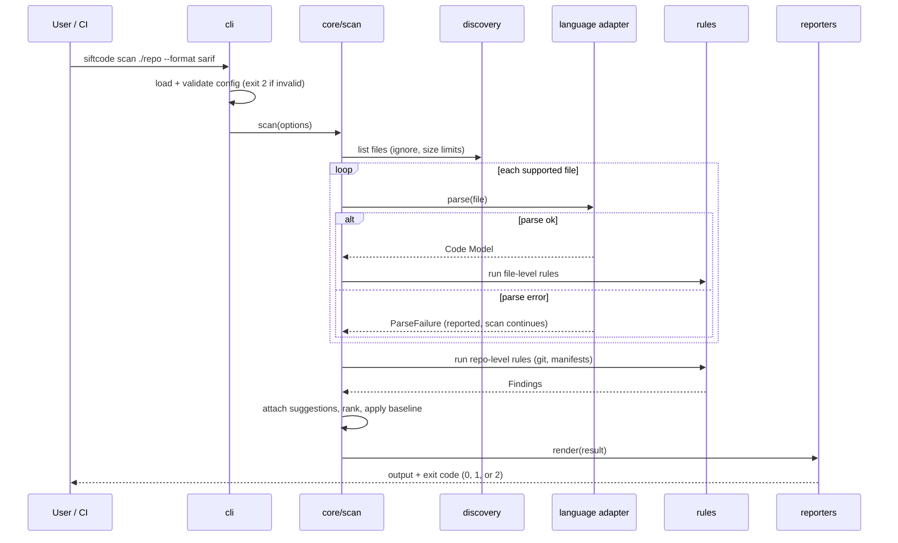

# SiftCode: Architecture

Status: plan, nothing built yet. Decisions: see [ADR 0001](adr/0001-typescript-and-tree-sitter.md). Requirements: see [PRD](PRD.md).

## 1. Stack and rationale

| Concern | Choice | Why |
|---|---|---|
| Language / runtime | TypeScript 6.0 (`strict`) on Node 24 or newer (LTS) | ADR 0001, ADR 0003 |
| Parsing | `web-tree-sitter` (the only runtime dependency) + compiled WASM grammars (JS, TS/TSX, Python, C#) copied from dev-only grammar packages into `grammars/` at build | One framework for many languages, no native compile, small package (ADR 0003) |
| Config validation | Zod, added in M1 | Schema is the single source for the config type and its error messages |
| CLI parsing | `node:util` `parseArgs` | Standard library, no dependency |
| Tests | Vitest | Fast, TypeScript-native |
| Lint / format | ESLint + Prettier, `tsc --noEmit` | Kickoff standard |
| Build | `tsc` to ESM + type declarations (no bundler) | Small, boring |
| CI | GitHub Actions | Repo is on GitHub |

Package names, publishers, licenses, and versions were verified against the registry in Milestone 0 (see ADR 0003). Install scripts are disabled and versions are pinned exactly.

## 2. Context



No network access during a scan. No code execution of the scanned project.

## 3. Containers and the scan pipeline



Key idea: **languages produce a Code Model, rules consume a Code Model.** A rule written once against the model works for every language that has an adapter. Rules that need raw syntax (e.g., a security sink pattern) are declared per language and use that language's tree-sitter queries.

## 4. Folder structure and module boundaries

Organized by feature, not file type. Each folder exposes a small public surface through its `index.ts`; nothing imports another module's internals.

```
src/
  cli/              argument parsing, exit codes, calls core/scan
  config/           schema, loading, defaults
  core/             scan orchestrator, finding model, severity/confidence types
  discovery/        file walking, ignore handling, limits
  languages/
    typescript/     adapter (covers JS/JSX/TS/TSX)
    python/         adapter
    csharp/         adapter
    model/          Code Model types (language-neutral)
  rules/
    metrics/        cyclomatic, halstead, maintainability
    design/         demeter, service-locator, srp
    security/       CWE pattern rules
    supply-chain/   lockfile, pinning, SBOM, CI signals
    documentation/  design/architecture artifact detection (diagrams, ADRs), freshness
    licenses/       license detection, adherence, dependency license compatibility (M4b; uses
                    bundled SPDX data and a versioned compatibility table)
    readiness/      testing-readiness hints
    (each rule is one file holding its metadata, suggestion text, and check: ADR 0004)
  git/              read-only history access (churn)
  reporters/        terminal, markdown, json, sarif, html (+ html/ assets)
  index.ts          public library API
test/
  fixtures/<language>/<rule>/{positive,negative}/...
```

Dependency direction (enforced by lint and by SiftCode's own rules): `cli → core → {discovery, languages, rules, git, reporters}`; `rules → languages/model` (types only); `languages` and `reporters` never import `rules`.

## 5. Data model



`fingerprint` is a hash of rule ID, file path, and a normalized code snippet (not line numbers) so baselines survive code moving around.

## 6. Critical flow: `siftcode scan`



## 7. Cross-cutting concerns

- **Errors:** specific error classes (`ConfigError`, `ParseFailure`, `UsageError`). A file that cannot be parsed never aborts the scan. Usage and config errors exit 2 with a message that says what is wrong and how to fix it. Stack traces appear only with `--debug`.
- **Logging:** human progress and diagnostics go to stderr; results go to stdout or `--output <file>`, so piping works. Levels: error, warn, info, debug. `NO_COLOR` respected.
- **Configuration:** `siftcode.config.json` validated by a schema; CLI flags override the file; defaults live in one module.
- **Determinism:** findings sorted by path, line, rule ID; no timestamps in finding data (the report header may carry one, excluded from SARIF/JSON comparison tests).
- **Security model (the tool analyzes untrusted code):**
  - never execute, import, or build scanned code;
  - cap file size and parse time per file; skip binary files;
  - do not follow symlinks outside the scan root; normalize paths;
  - no network access in the scan path; no telemetry;
  - HTML report escapes all code-derived text and ships no remote scripts or fonts;
  - rule regexes are reviewed for catastrophic backtracking, and run on bounded input;
  - code snippets in reports are redacted for matched secrets (never print a found secret in full).
- **Performance:** files are processed one at a time; syntax trees are freed as soon as the Code Model is extracted. Measured by `npm run benchmark` on 2026-10-31 (Windows, Node 26): 500 files / 52,375 lines in 0.74 s (about 70,000 lines/s), peak memory about 101 MB, against the NFR-4 target of 30 s. Worker threads are not needed yet; revisit if rules grow much heavier.
- **Extensibility:** a rule is a plain object (`id`, `category`, `run(model) → findings`) plus a catalog entry (standards, rationale, suggestion). New rules and new languages are added without editing the orchestrator.
- **Self-checking:** CI runs SiftCode on its own source (PRD US-072).
